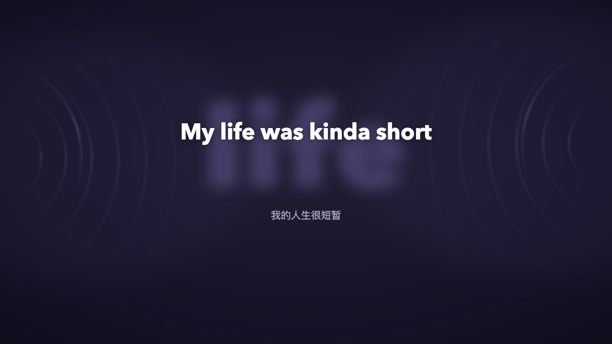

# 动感波光 / wave-light

一个 [Folia](https://github.com/chthollyphile/folia-major)（Folium 1 模组系统）模组：新增一个**歌词动画模式**「动感波光」——选中它时，播放页面变成一片随封面主色呼吸的暗色水面：左右两侧各有一组缓缓转动、明灭的同心圆波纹，当前句歌词**居中放大**，背后浮着一行取自歌词的超大**关键字水印**，外语歌的翻译固定在**左下角**显示。效果参考 QQ 音乐的「动感波光」播放页。

**不选中这个模式时完全不渲染**，与内置及其他模组的歌词样式互不影响。



## 使用

在播放界面的**动画模式选择器**里选「动感波光」即可。切回其他模式，波光立即消失。

## 功能

- **封面取色**：自动提取当前歌曲封面的主色（24×24 降采样加权提取，本机完成，不联网），背景暗色水波、波纹、歌词颜色全部由它派生；切歌自动换色。无封面 / 封面不可读时回退主题强调色。
- **左右双声波**：两组同心圆波纹分居屏幕左右边缘（圆心探出屏外），像喇叭声波一样逐环放大、缩小，亮度和扩张的波峰由内向外推进，并有几道亮弧缓缓旋转；canvas 加法混合绘制，暂停时依然流动（参考原效果）。
- **居中大歌词**：当前句歌词与水印共用同一中心点，居中放大（约为页高的 8.5%，可调），间奏期无歌词时显示「歌名 - 歌手」。**逐字入场动效**：中心字先由模糊变清晰浮现，两侧字同时从左右向中心靠拢汇入、逐字错峰，全部由模糊收敛到清晰；外语单词整体滑入不拆分。
- **关键字水印**：随机取当前句中 **2–4 个连贯字**（中文/日文按字、外语取一个单词）——不是固定首字，每句随机、位置长度随句变化但句内保持稳定——以超大深色字号浮在歌词背后，与歌词同点心，换行时淡入，字数多时自动缩小。
- **翻译独立成块**：外语歌的翻译在屏幕下方单独显示（水平居中，垂直位置取「背景大字底缘与屏幕底部的中点」，随水印大小自适应），不嵌入歌词列，当前句没有翻译时自动隐藏。
- **主题联动**：字体栈、字重取自当前主题。
- **间奏保持**：句间空行 / 歌词时钟间隙时保持上一句歌词，不会闪现歌名。

## 设置

选中该模式后，在动画模式的设置面板里调整：

| 设置 | 说明 |
| --- | --- |
| 波光配色 | 跟随封面主色（默认）/ 主题色 |
| 波光亮度 | 波纹与光晕的整体强度（默认 1，可 0.3–2） |
| 流动速度 | 波纹放大缩小、旋转的快慢（默认 1，可 0.2–3） |
| 关键字水印 | 歌词背后的超大水印，随机 2–4 个连贯字（默认开） |
| 歌词字号 | 叠加在主题字号与用户歌词字号之上 |

## 安装

把 `wave-light/` 文件夹放进 Folia 的模组目录后重启：

```
~/Library/Application Support/Folia/mods/wave-light
```

首次启用时 Folia 会弹出确认窗口（列出内容指纹），确认后即可使用。

## 实现说明

- 通过公开注册表 `folium.registries.visualizers` 注册一个动画模式，`hostLayers: { background: false, subtitles: false }`——整个页面（背景 + 歌词）由模组自绘，宿主不再铺自己的背景层。
- 背景 = 封面主色派生的径向暗色渐变（DOM）；双声波 = 单个 canvas，requestAnimationFrame 每帧绘制两组同心圆（半径逐环放大缩小的行波 + 由内向外推进的发光「声波脉冲」环，亮度沿竖直方向成带状渐变）+ 旋转亮弧（加法混合，DPR 上限 1.75，开销很低）；歌词 / 关键字水印 / 翻译 = DOM 文本，走主题字体。
- 关键字水印的随机选取以整句文本做 FNV-1a 哈希播种，同一句稳定、不同句各异；先剔除标点空格再截取，保证连贯。
- 主色提取与「黑胶唱片」模组同源：24×24 降采样、按饱和度 × 中间调加权，跨域污染时静默回退，按封面 URL 缓存。
- 不声明任何权限；不碰宿主 DOM、不注入全局样式、不联网。

## 权限

无。该模组只用动画模式注册表与上下文读取，不需要 `playback.read` 等任何权限。

## 隐私

不联网、不上传任何数据；主色提取在本机完成，设置由宿主保存在本机。

## 更新日志

- **1.4.2**：居中改为**锚定视口**——运行时测量模组容器在屏幕上的实际矩形，把歌词、背景大字、翻译全部锚定到可视页面中心（而非容器的 50%）。宿主容器若有内边距、偏移或被宿主移动/缩放，文字层每 500ms 自动重新校正；容器与页面一致时行为不变。
- **1.4.1**：①歌词与背景大字恢复严格同心居中（1.4.0 把翻译放进居中列，把歌词顶偏了——现在居中列只放歌词一行）；②翻译改为独立块：屏幕下方、背景大字底缘与屏幕底部连线的中点位置（随水印大小动态计算），水平居中。
- **1.4.0**：修复三处——①歌词特效在宿主重挂载后不播放（现在无论宿主以哪条路径重建模式，逐字入场动画都会播放）；②播放几句后闪现歌名（句间空行 / 歌词时钟间隙现在保持上一句歌词，歌名只在歌曲开头显示）；③翻译位置改到歌词正下方居中（原左下角），随歌词行数自适应；并修复中心列 `display:flex` 被运行时清空导致歌词顶到页面顶部的问题。
- **1.3.0**：歌词逐字入场动效——换句时中心字先在原地由模糊变清晰浮现，两侧的字同时从左右向中心靠拢汇入（按离中心的距离逐字错峰，位移与模糊度同步收敛），外语单词整体滑入不拆分；水印仍先于歌词浮现。另修复翻译元素误用带位移的入场动画类导致的位置偏移。
- **1.2.0**：按反馈调整——波纹改为喇叭声波式「放大缩小」（行波逐环推进 + 由内向外扩张消散的声波脉冲环）；歌词改为与水印同一锚点绝对居中（此前仅水印居中）；关键字水印不再固定取首字，改为每句随机取 2–4 个连贯字（外语取随机单词），按句哈希保持句内稳定，多字时自动缩小防溢出。
- **1.1.0**：按 QQ 音乐参考重构——背景改为左右两组会动的同心圆波纹（原为横向光带）；歌词居中放大、去掉曲名/歌手小标题与下一句预览，间奏期显示「歌名 - 歌手」；新增歌词背后的超大关键字水印（可关）；翻译改为固定左下角显示（原为歌词下方居中）。
- **1.0.0**：首个版本。

## 许可证

[MIT](wave-light/LICENSE)
